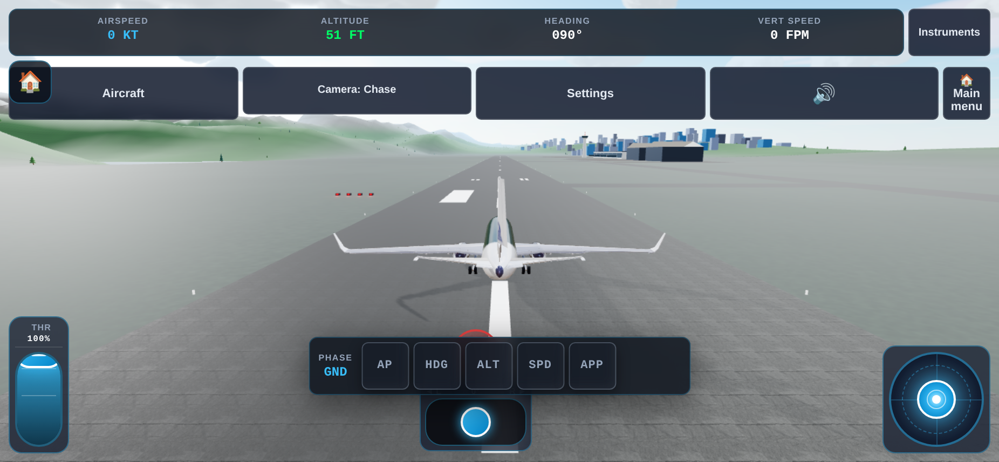

# ✈️ Flight3D

### Ultra-realistic 3D browser flight simulator powered by Three.js & Vite

[](https://stlim0727.github.io/flight3d/)
[-success?style=for-the-badge)](tests)
[](https://threejs.org)
[](https://vitejs.dev)
[](https://nodejs.org)

**[🎮 Launch Simulator](https://stlim0727.github.io/flight3d/)** · **[📖 Architecture Docs](ARCHITECTURE.md)**

---

<p align="center">
  
</p>

**Flight3D** delivers desktop-grade flight simulation directly to your browser—zero installation required. Powered by a **continuous 6-DOF aerodynamic physics engine**, an authentic **PBR glass cockpit with real-time sunlight and window frame shadows**, an expanding multi-aircraft fleet (**Boeing 737-800**, **Cessna 172 Skyhawk** & **F-16 Fighting Falcon**), and challenging global destinations ranging from **Pacific Coastal International** to Nepal's perilous high-altitude **Lukla Airport (VNLK)**.

---

## ✨ Visual Showcase

| ✈️ Multi-Aircraft Fleet | 🏔️ Extreme Himalayan Approach (Lukla VNLK) |
| :---: | :---: |
|  |  |
| **Cessna 172 Skyhawk** & Boeing 737-800 | **Tenzing-Hillary Lukla** (11.7% sloped mountain strip, 9,334 ft) |

| 🌅 Scenic Coastal Banking | 🎯 3NM Precision PAPI Approach |
| :---: | :---: |
|  |  |
| Wing view over coastal bay with Rayleigh aerial fog | Runway 09L with active 4-box PAPI & MALSR lighting |

| 🖥️ Authentic Glass Cockpit (PFD / ND / EICAS) | 🚢 Living Ocean & Marine Fleet |
| :---: | :---: |
|  |  |
| High-rate canvas avionics, F/D crossbars & V-speed bugs | Gerstner ocean waves, buoyancy physics & ship wakes |

| 📱 Responsive Mobile Touch Controls | 🛫 Runway 09L Takeoff Roll |
| :---: | :---: |
|  |  |
| Virtual gyro flight stick, throttle quadrant & rudder pills | PBR asphalt/concrete pavement, TDZ markings & airport kit |

---

## ⚡ Highlights

- **🔬 6-DOF Flight Dynamics:** Continuous aerodynamic state modeling with non-linear lift/drag polar, stall separation & hysteresis, wing-drop tendencies, and wingtip ground effect.
- **✈️ Expanding Aircraft Fleet:**
  - **Boeing 737-800:** 66-ton airliner, CFM56-7B turbofans with spool-up delay, reverse thrust, and PCU hydraulic rate limits.
  - **F-16 Fighting Falcon:** User-selected 3D cockpit model with telemetry-driven retractable gear; noncommercial asset license.
  - **Cessna 172 Skyhawk:** 1,050 kg high-wing general aviation trainer with Lycoming IO-360 engine and fixed tricycle gear.
- **☀️ Real-time Cockpit Sunlight & Shadows:** Dynamic sun position casts crisp window frame, A-pillar, and yoke shadows across the instrument panel with ambient daylight occlusion.
- **🗺️ Global Airfields & Terrain:**
  - **Pacific Coastal International (09L/27R):** 3,200m runway, calibrated 4-lamp PAPI ($3.0^\circ$ slope), MALSR running rabbits, terminal concourse & rotating radar tower.
  - **Tenzing-Hillary Lukla (VNLK):** 527m runway with an extreme 11.7% ($6.69^\circ$) uphill slope, altitude 2,845m (9,334 ft), real SRTM elevation data and satellite texturing.
- **🛠️ Landing Gear & Damage:** Non-linear oleo-pneumatic struts, wheel spin-up friction, anti-skid brakes, structural overload failure, and post-collapse body friction.
- **🎬 Autonomous Cinematic Director:** Multi-stage demo flight for both Coastal and Lukla circuits with instant zero-latency handover upon user control input.
- **📱 Touch & Mobile Ready:** Responsive virtual flight stick, progressive throttle slider, rudder buttons, and full smartphone/tablet support.

---

## 🚀 Quick Start

Ensure you have **Node.js 22.23.2+** installed:

```bash
# Clone repository
git clone https://github.com/stlim0727/flight3d.git
cd flight3d

# Install dependencies
npm ci

# Launch local dev server (default port 5173)
npm run dev
```

Open **`http://localhost:5173/`** in Chrome, Edge, Safari, or Firefox to fly immediately.

### Verification & Testing

```bash
npm run check    # Verify syntax & pinned GitHub Action references (186 files)
npm test         # Run 491 unit tests across 59 suites (100% pass)
npm run build    # Production build into dist/
```

---

### Direct flight URLs

Open a specific flight with query parameters, for example:
[ C172 coastal approach](https://stlim0727.github.io/flight3d/?aircraft=C172&terrain=coastal&scenario=approach).
The [flight URL directory](https://stlim0727.github.io/flight3d/flights.html)
lists every supported aircraft/terrain/scenario combination with filters.

- `aircraft`: `B738`, `C172`, `F16` (case sensitive).
- `terrain`: `coastal`, `lukla`, `incheon`, `neon`, `hangang`.
- `scenario`: `runway`, `approach`, `cruise`, `cliff`, `demo`, `hangang`, subject to terrain and aircraft availability.

URL values override saved preferences. Omitted values use the saved selection;
invalid or unavailable choices fall back to the existing defaults. Hangang uses
C172 only. Flights still follow browser audio permission rules.

## 🎮 Flight Controls

### Flight Controls
| Control | Key | Action |
| :--- | :--- | :--- |
| **Pitch (Elevator)** | <kbd>W</kbd> / <kbd>S</kbd> or <kbd>↑</kbd> / <kbd>↓</kbd> | Push nose down / Pull nose up |
| **Roll (Ailerons)** | <kbd>A</kbd> / <kbd>D</kbd> or <kbd>←</kbd> / <kbd>→</kbd> | Bank left / Bank right |
| **Yaw (Rudder / Steering)** | <kbd>Q</kbd> / <kbd>E</kbd> | Rudder left / right (nosewheel steering on ground) |
| **Throttle** | <kbd>=</kbd> / <kbd>−</kbd> | Increase / decrease thrust |
| **Throttle Presets** | <kbd>X</kbd> / <kbd>Z</kbd> | Maximum TOGA (100%) / Flight Idle (22–25%) |
| **Wheel Brakes** | <kbd>Space</kbd> | Apply wheel brakes |
| **Pitch Trim** | <kbd>T</kbd> / <kbd>Y</kbd> | Nose down trim / Nose up trim |
| **Flaps** | <kbd>F</kbd> / <kbd>V</kbd> | Extend flaps / Retract flaps |
| **Landing Gear** | <kbd>G</kbd> | Toggle landing gear (retractable on 737) |
| **Speedbrakes (Spoilers)** | <kbd>B</kbd> | Deploy / stow flight spoilers |
| **Reverse Thrust** | <kbd>R</kbd> | Toggle turbofan thrust reversers (after touchdown) |
| **Engine Failure Sim** | <kbd>K</kbd> | Cycle simulated engine failure (Both $\rightarrow$ Left off $\rightarrow$ Right off $\rightarrow$ Restore) |

### Views & Environment
| Function | Key | Action |
| :--- | :--- | :--- |
| **Camera Views** | <kbd>1</kbd> ~ <kbd>8</kbd> / <kbd>C</kbd> | Cockpit (1), Chase (2), Flyby (3), Wing (4), Tower (5), Gear (6), Drone (7), Top-Down (8) |
| **Look Around** | <kbd>Mouse Drag</kbd> | 360° cockpit gaze (Double-click to reset view) |
| **Time of Day** | <kbd>[</kbd> / <kbd>]</kbd> | Dawn $\rightarrow$ Noon $\rightarrow$ Golden Hour $\rightarrow$ Dusk $\rightarrow$ Night |
| **Exterior Lights** | <kbd>L</kbd> | Toggle nav, beacon, strobe, and landing lights |
| **Audio** | <kbd>M</kbd> | Toggle jet engine, ambient wind, and GPWS audio |
| **Autonomous Demo** | <kbd>P</kbd> | Start / replay cinematic autonomous demo |
| **Menu / Pause** | <kbd>Esc</kbd> | Open Lobby Screen (select aircraft, airport, spawn preset, or language) |
| **Physics Inspector** | <kbd>`</kbd> or <kbd>F3</kbd> | 120Hz live telemetry, G-force/AoA telemetry & tuning panel |
| **Crash Restart** | <kbd>Space</kbd> / <kbd>R</kbd> | Immediate full airframe reset on runway |

---

## 📁 Repository Structure

```
flight3d/
├── src/
│   ├── aircraft/          # 3D models (B737, C172), virtual cockpit, apertures & control surfaces
│   ├── audio/             # Web Audio procedural turbofan spool, wind rush & GPWS callouts
│   ├── avionics/          # PFD, ND, EICAS, MCP, ISFD & CDU canvas flight instruments
│   ├── cameras/           # Cockpit, chase, wing, tower, gear cam & mouse gaze tracking
│   ├── config/            # Aircraft configs (aircraftConfigs.js), scenarios & sim tuning
│   ├── controls/          # Dynamic pressure controls (FlightControls) & mobile touch (TouchFlightControls)
│   ├── director/          # Autonomous flight director (Coastal & Lukla circuits)
│   ├── effects/           # Particle explosions, fireballs, shockwaves & water plumes
│   ├── environment/       # Airports (Coastal, Lukla), PBR runways, Gerstner ocean, ships, cockpit shadows
│   ├── i18n/              # Bilingual English / Korean localization
│   ├── physics/           # 6-DOF aerodynamics, engines, oleo gear, trim solver & collision detection
│   └── ui/                # HUD overlays, lobby screen, diagnostics inspector & flight panels
├── tests/                 # 491 automated unit tests across 59 suites (100% pass)
├── scripts/               # Headless Chrome CDP autonomous flight agents & screenshot tools
└── docs/development/      # Agent task maps, physics principles, and working rules
```

---

## 📄 License

Distributed under the [MIT License](LICENSE).
External 3D models and sound assets follow their respective licenses in `src/environment/*LICENSE*.txt` and `public/models/*.LICENSE.txt`. The F-16 asset by [bohmerang](https://sketchfab.com/bohmerang) is **CC BY-NC-SA 4.0 (noncommercial only)**; the MIT code license does not override its asset license. See [F-16 integration notes](docs/development/f16.md).
