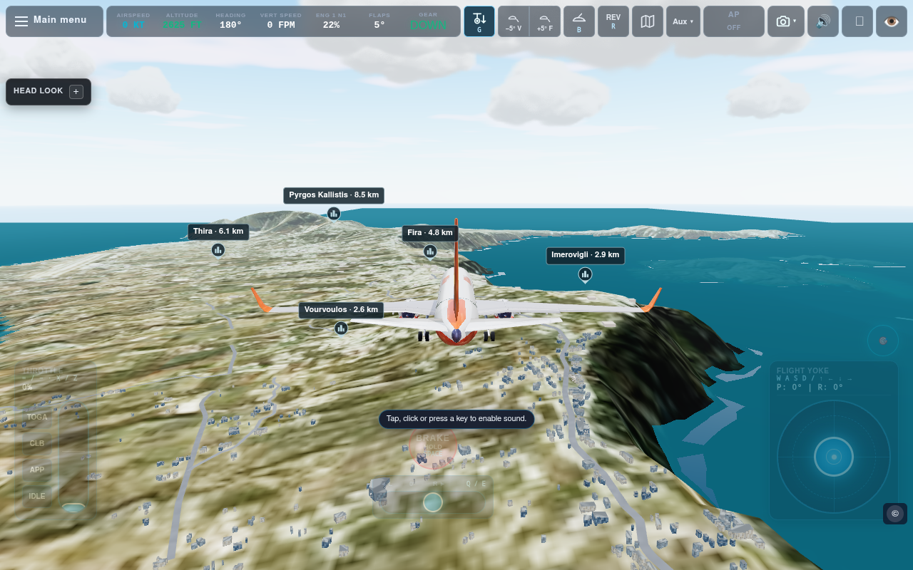

# 분산 애드온 계약 POC (Discussion #1045)

## 결과 요약

핵심 계약과 해석기를 코어와 분리된 순수 모듈로 구현하고, 외부 팩을 버전 고정으로
해석해 기존 타일 캐시에 주입하는 경로를 검증했다. 앱의 지역 스폰 분기
(`src/core/PresetSpawner.js`)는 수정하지 않았다.

| 산출물 | 위치 |
| --- | --- |
| v1 스키마/해석기 | `src/addons/addonContract.js` |
| 프로필 → 타일 URL 바인딩 | `src/addons/regionPackBinding.js` |
| 발행자 CI용 검증 CLI | `scripts/addon-contract.mjs` |
| 외부 저장소 fixture | `examples/external-region-pack/` |
| 테스트 | `tests/addonContract.test.js`, `tests/regionPackBinding.test.js`, `tests/addonTileFallback.test.js` |

## 검증된 동작

- `addon.json` v1: namespace ID, publisher, semver, 호환 코어 범위, 의존성,
  라이선스/출처, 지역 경계·origin·vertical datum·타일 포맷/체크섬을 검증한다.
- 카탈로그는 addon ID당 하나의 정확한 버전을 pin하고, 매니페스트를 받은 뒤
  SHA-256과 ID/버전을 확인한 후에만 의존성을 재귀 해석한다.
- 해석 결과를 프로필로 직렬화해 공유 URL에 base64url로 담고, 다시 읽어 같은 pin을
  재현한다. 이전 버전의 pin으로 교체하면 해당 버전 타일 URL이 그대로 사용된다.
- 버전은 타일 URL 경로에 삽입되고 `TileCacheManager`의 `urlTemplate`로 주입된다.
  타일 요청이 실패하면 캐시가 `null`을 반환하므로 기본 지형/ procedural material이 유지된다.
- `node scripts/addon-contract.mjs validate <file> [--core VERSION]`로 외부 저장소 CI에서
  같은 스키마를 실행할 수 있다.

## 테스트 결과

- `node tests/addonContract.test.js`: 4/4 pass
- `node tests/regionPackBinding.test.js`: 2/2 pass
- `node tests/addonTileFallback.test.js`: 1/1 pass
- `node --check` on new modules: pass

_full build not verified in this isolated snapshot_: the shared checkout's
`node_modules` lacks `polygon-clipping`, unrelated to these files.

## 남은 작업 / 결정 필요

1. 앱 부팅 시 `?profile=`을 읽어 `resolveProfile`을 호출하고, 지역 스폰 경로가
   외부 origin/vertical datum을 받도록 `PresetSpawner`에 data-driven adapter를 추가.
2. 공식 프로필 승인 기준과 지역 팩 중복 해소 규칙은 코드가 아닌 거버넌스 문서로 결정.
   예: 패치 버전은 자동, 경계/vertical datum 변경은 메인테이너 검토.
3. 기체·시나리오 타입의 스키마는 선언만 하고 런타임 등록은 후속 범위.
4. 외부 스크립트 실행은 sample pack에 포함하지 않는다.

## browser evidence status

아직 없음. 다음 단계에서 하드웨어 GPU Chrome으로
`node scripts/verify-browser-gpu.mjs <CDP endpoint>`를 먼저 실행하고, 외부 팩 타일의
정상 로딩·지연/실패 폴백·이전 버전 롤백을 실제 비행 중 확인해야 한다.

## Expanded examples (four addon kinds)

The first POC only modelled region tiles. The following examples show why the
contract needs capability-specific sections and a set-level linter:

| Example | Manifest | Contract surface |
| --- | --- | --- |
| New aircraft | `examples/packs/aircraft/addon.json` | physics profile + mass/area/spans, GLB model and cockpit, control node bindings, license/attribution |
| Building overrides only | `examples/packs/buildings/addon.json` | one Overture selector, optional bounds, replacement GLB, material colors, collision policy; no tile replacement needed |
| Ocean/look palette | `examples/packs/palette/addon.json` | deep/shallow sea colors, haze color, roughness range; uniform overrides only, no shader source |
| Scenario | `examples/packs/scenario/addon.json` | exact start frame, supported objective union, declarative events, pinned required addons |

### Why the scenario contract is deliberately narrow

v1 allows only declarative objectives (`reach-waypoint`, `maintain-altitude-band`,
`land-at`, `photograph-landmark`) and declarative events
(`set-briefing`, `advance-objective`, `complete-scenario`). Scripts, arbitrary
network calls and code execution are rejected by both the schema and the linter.
This keeps a shared profile deterministic and reviewable: two machines with the
same pins must get the same flight, not two different script builds.

The linter checks the **set**, not just individual files:

- exact version matches between dependencies and published manifests;
- scenario required addons are pinned, including exactly one aircraft pack;
- referenced landmark IDs exist in a building-override pack;
- asset hosts are allow-listed and checksums are present;
- building overrides stay inside a covered palette/region bounds;
- scripts and unsupported targets fail before the flight starts.

Run it with:

```sh
node scripts/addon-contract.mjs lint-set examples/packs/*/addon.json --core 1.8.0
```

Example regression tests are in `tests/addonExamples.test.js`.

## Verification update

- `node tests/addonExamples.test.js`: 4/4 pass
- `node scripts/addon-contract.mjs lint-set examples/packs/*/addon.json --core 1.8.0`: OK, 0 warnings
- All four example manifests pass `validate` with `--core 1.8.0`

## Browser evidence (hardware GPU Chrome)

Preflight and page-level checks ran in Chrome 158 headless with hardware
Vulkan acceleration:

- `scripts/verify-browser-gpu.mjs` passed against `127.0.0.1:9447`:
  WebGL2 context, renderer `ANGLE (Intel, Vulkan 1.4.335 (Intel(R) Graphics (ADL-N)), Intel open-source Mesa driver)`,
  shader draw + readPixels `[255,0,0,255]`, GL error 0.
- A URL carrying a valid pinned manifest booted the app and exposed
  `window.sim.pinnedAddonPack` with the exact version `1.0.0`, checksum
  `9ea4fd…`, and tile template `https://packs.example/poc/tiles/1.0.0/{z}/{y}/{x}.png`.
- The same URL with a deliberately wrong `addonSha256` did not create `window.sim`
  and showed the startup failure overlay. The deterministic checksum rejection
  is also covered by `tests/addonContract.test.js` and `tests/addonTileFallback.test.js`.

The browser probe did not capture a console exception string for the rejected
case because Flight3d catches it before `window.onerror`; the visible failure
state and Node tests are the evidence recorded here.

## External addon repository example

A real external repository was created for the POC:
https://github.com/stlim0727/flight3d-addon-poc

It publishes:

- `addon.json` (`demo/region/kos-gulf-pack@1.0.0`)
- `catalog.json` pinning the manifest URL and its SHA-256
- `npm run validate` / `npm run lint` scripts using Flight3d's contract CLI
- a GitHub Actions workflow that runs `validate` on push/PR

The core POC catalog at `examples/external-region-pack/catalog.json` pins the
live raw manifest URL. `resolveProfile()` fetched it successfully and returned
the exact pinned ID, version, checksum `882e0e41…`, and tile URL. This confirms
the intended flow: an external maintainer publishes and validates in their own
repository, while Flight3d reads only pinned, checksum-verified releases.

## Santorini region addon (runtime visual integration)



`examples/packs/santorini/addon.json` is a pinned `med/region/santorini@1.0.0`
pack with an Aegean sea palette, pastel haze and a whitewashed building override.
The previously declaration-only `region.palette` and `region.buildingOverrides`
sections now reach the renderer through `src/addons/regionVisuals.js`:

- sea `deepColor`, `shallowColor`, `roughness` and `daylightScale` configure both
  the water mesh and the far-sea pass in the screen sky;
- sky `hazeColor` is kept as a time-of-day base colour so updates do not erase it;
- building overrides select Overture features by bounds, `overtureId` or
  `nameContains` and apply `material.baseColor` as a vertex tint; `suppress`
  removes matching building polygons;
- the pinned versioned tile URL is injected into `OpenWorldTerrain`'s imagery
  cache, with the default Esri satellite cache as a fallback when a tile is
  unavailable;
- the satellite terrain shader tints only Overture water-mask pixels with the
  palette's shallow sea colour, so the Aegean colour appears over the satellite
  image without recolouring land.

The example tile and GLB URLs use `packs.example` and do not publish assets:
the pack proves the contract and shader/override wiring, not a hosted Santorini
imagery set. GLB replacement meshes from `override.model` are validated by the
addon runtime verifier but are not yet instantiated by the streamed building
layer; only their declared material colour and collision policy are consumed.

Verification: `node --test tests/santoriniAddon.test.js` plus the related addon,
far-sea, water and city focused tests pass. Hardware Chrome 158 with an Intel
Vulkan renderer passed `scripts/verify-browser-gpu.mjs` (WebGL2, shader draw,
`readPixels [255,0,0,255]`, GL error 0) and booted the pinned Santorini pack in
both lobby and flight. `flight-persona` reported no anomalies on a four-tick
C172/Neon sortie; that sortie does not exercise Santorini-specific terrain.
