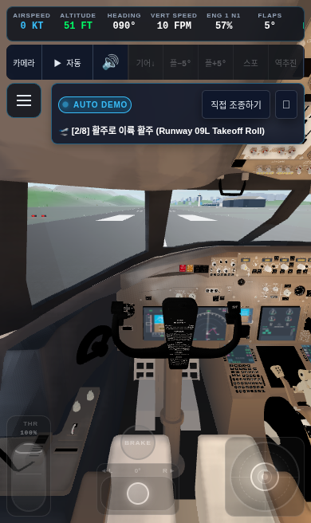
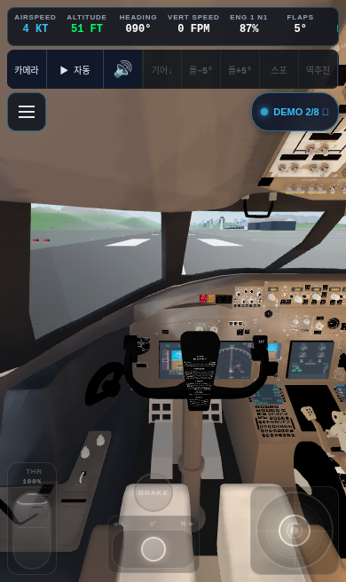

# Demo guide placement

The guide and its collapsed control sit at the right edge, 4px below the measured
flight toolbar. On portrait phones the guide shares the menu button row without
overlapping it. The collapsed control retains a 44px touch target and displays
only DEMO, the current stage, and the expand indicator.

Browser acceptance used the reusable flight3d Chrome session via CDP against
local Vite. Viewports: 390×656, 320×568, 844×390, and 1440×900, with touch
emulation for the first three. At each size, native input closed and reopened the
guide. Checks passed for viewport bounds, toolbar clearance, hit testing, no
horizontal content overflow, and a collapsed width below 140px / height 44px.
Observed collapsed size: 98.66×44px. No uncaught browser exceptions were observed.
This was a UI check, not a complete autonomous flight acceptance run.

The attached 390×656 screenshots capture both states after startup notifications
have disappeared. Existing responsive acceptance assertions in
`scripts/verify-responsive-ui.mjs` now check the new menu-relative position and
collapsed control size; that full multi-feature script was not run for this change.

