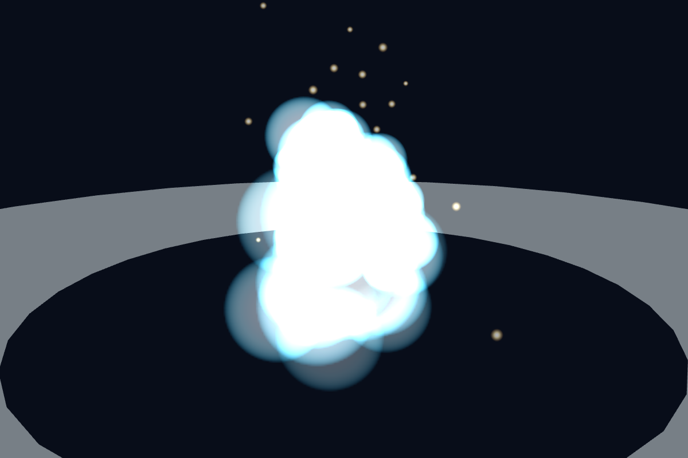
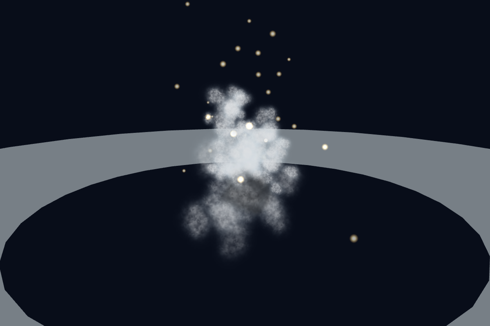
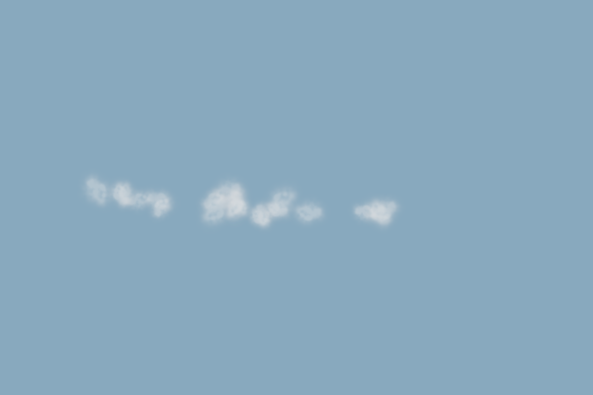
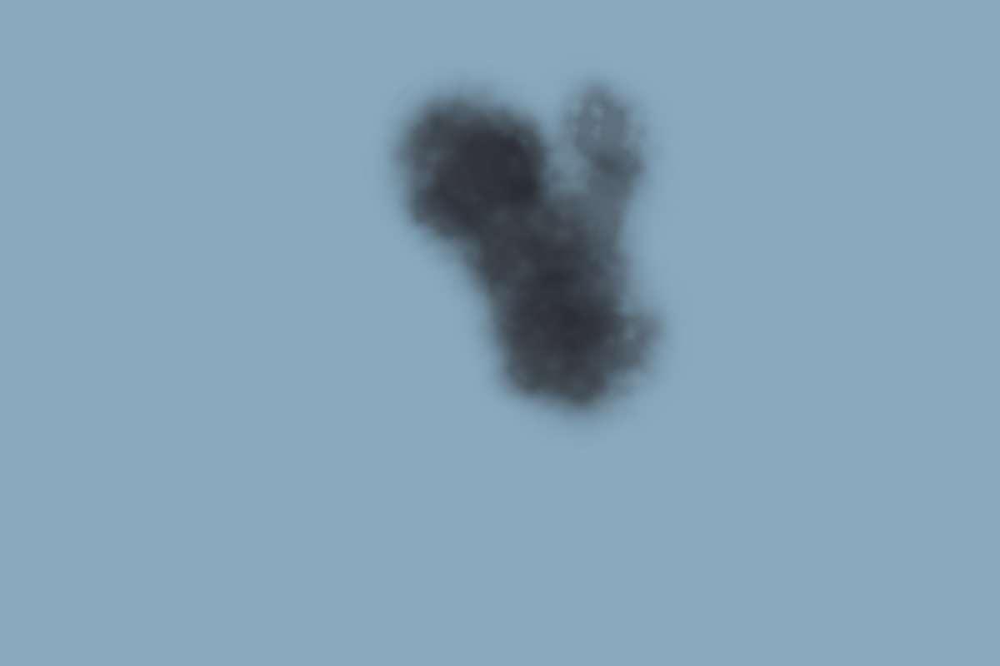
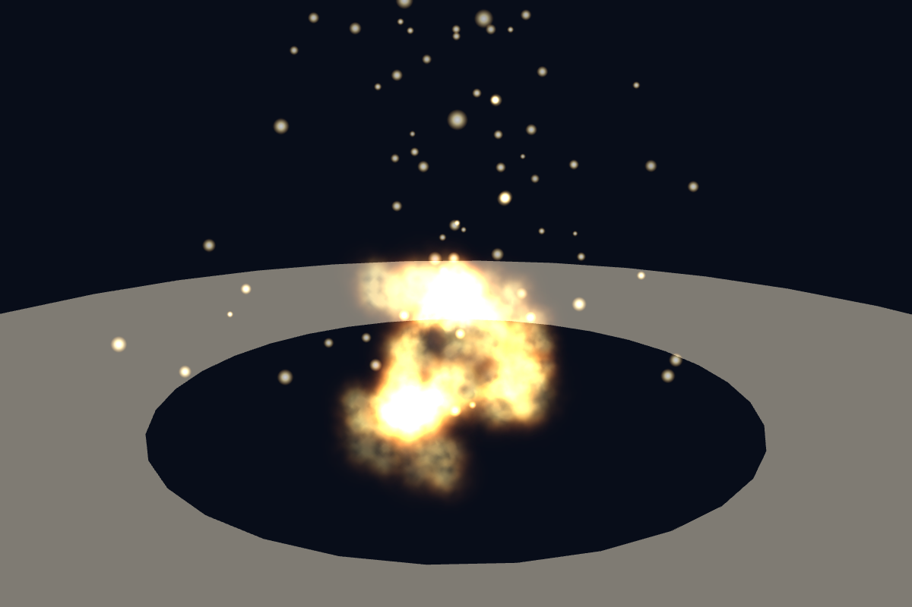

# Effect flipbook acceptance

2026-10-22, Windows, Intel Core Ultra 7 256V, Chrome 155, ANGLE SwiftShader.
Node 22.23.2. Baseline: 31bede9, final original procedural atlas implementation.
16 paired captures: same seed, pose, camera, time and 1200x800 resolution.
See [procedure and limitations](../../docs/development/effect-flipbooks.md).

| Scenario | Draw calls before / after | Median ms before / after | P95 ms before / after |
| --- | --- | --- | --- |
| tire day | 20 / 20 | 0.40 / 0.20 | 1.40 / 0.40 |
| tire night | 20 / 20 | 0.20 / 0.10 | 0.40 / 0.20 |
| land day | 218 / 218 | 1.90 / 1.00 | 4.60 / 2.30 |
| land night | 218 / 218 | 1.30 / 1.30 | 2.90 / 2.90 |
| water day | 188 / 188 | 1.50 / 1.30 | 3.30 / 2.50 |
| water night | 188 / 188 | 1.50 / 1.30 | 3.90 / 2.60 |
| smoke day | 20 / 20 | 0.10 / 0.10 | 0.30 / 0.30 |
| smoke night | 20 / 20 | 0.10 / 0.10 | 0.30 / 0.20 |

Four atlases plus unchanged spark: estimated RGBA GPU allocation including
mips grows from 92,843 to 1,054,037 bytes; atlas allocation is fixed.
Texture image transfer remains zero (generated in code). Production app JS
gzip grows from 314.63 kB to 315.51 kB, measured by Vite builds with only the
two effect modules replaced for baseline. License is shipped in public/licenses.
All 20 reset cycles keep GPU geometry/texture/program counts stable; final
disposal leaves zero textures. Full results: [results.json](results.json).

These static isolated effects have the same draw counts and bounded sprite
areas/lifetimes, but retain per-sprite draw calls and alpha overdraw. CPU/GPU
load and scheduling noise affect timings; this is not a whole-flight FPS test.
No hardware-GPU or mobile performance claim. Hard memory/particle budgets
are checked by the browser harness; timing is reported rather than gated.

Visual inspection: no black fringes or atlas-tile seams; irregular lobe
structure replaces circular blobs and the rejected periodic grid prototype.
Water no longer saturates to a solid white additive shape at night. Fire
keeps an intentionally bright additive core, with a smaller saturated area.
The unchanged shockwave remains a bright, solid ring.

## Water at night

Before:

After:

## Touchdown smoke

Before:

After:

## Dark smoke at three seconds

## Land fire at night

