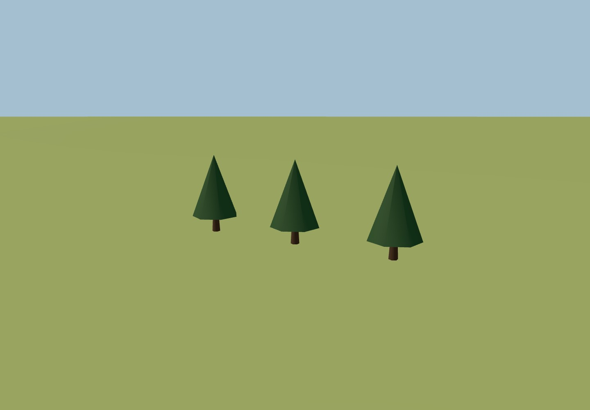
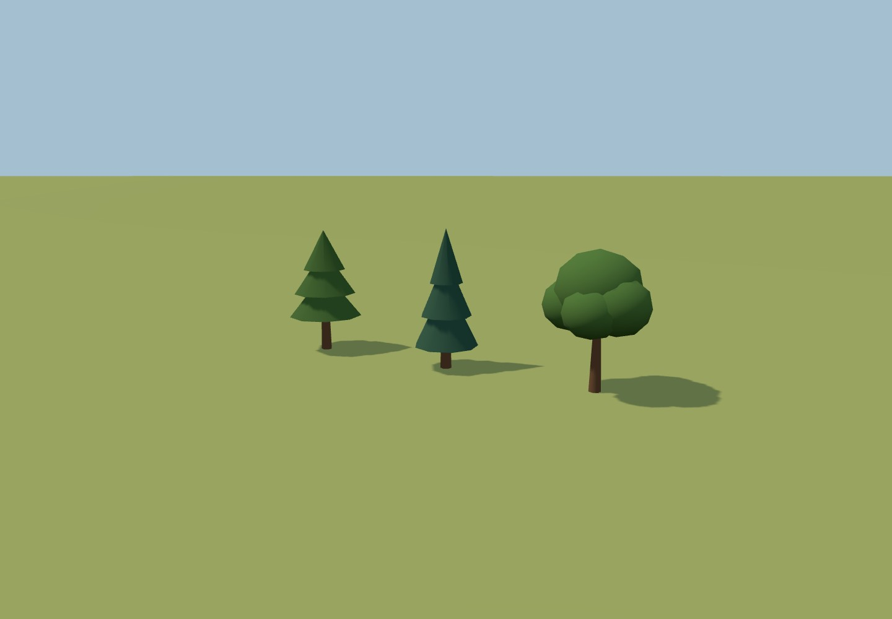
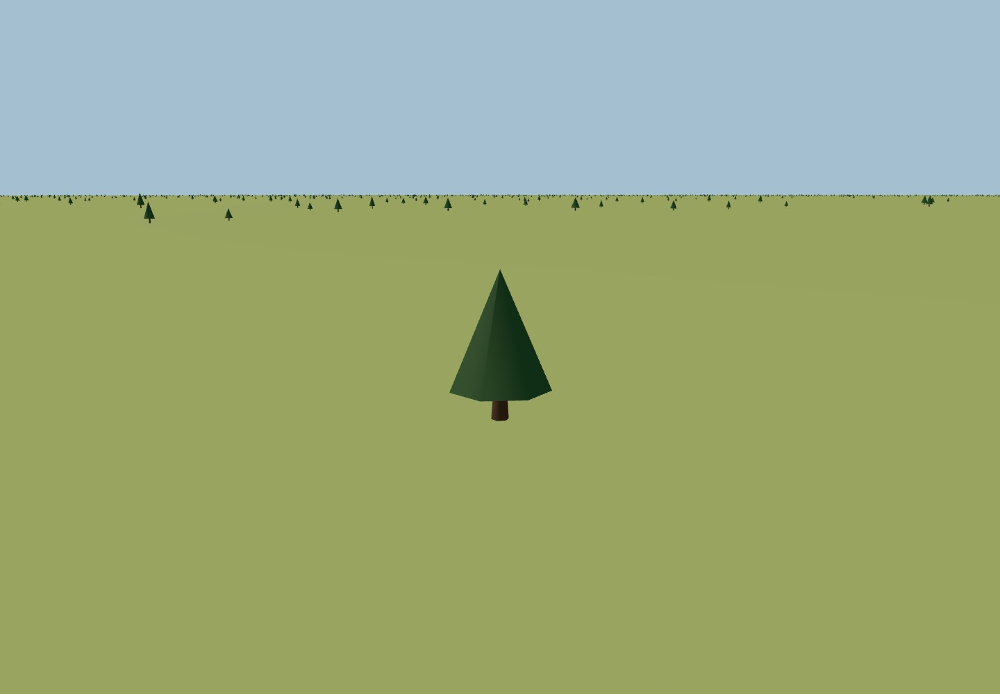
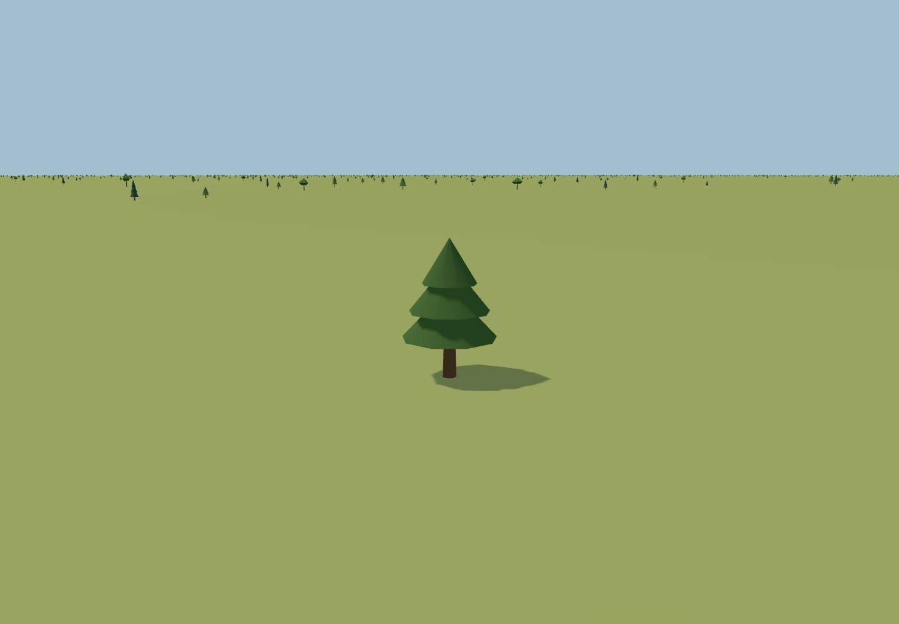
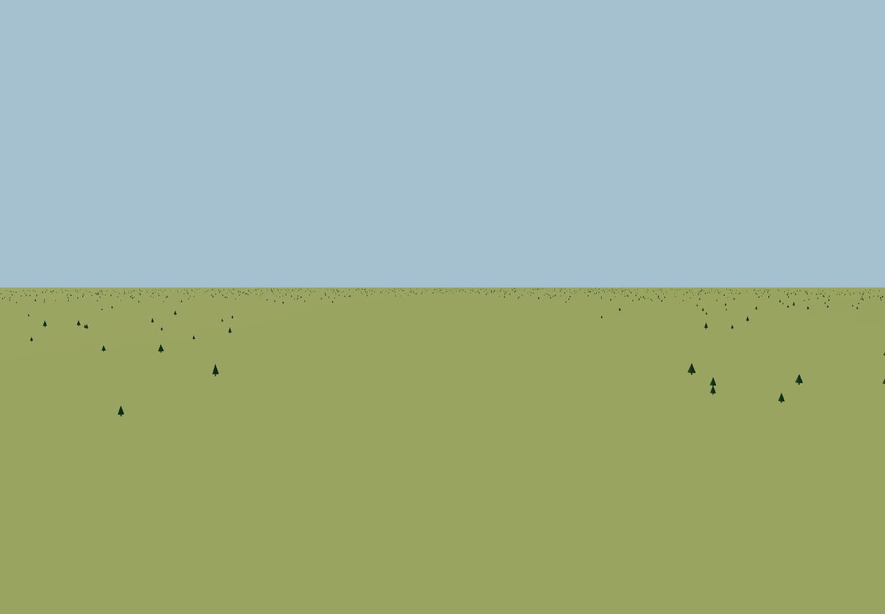
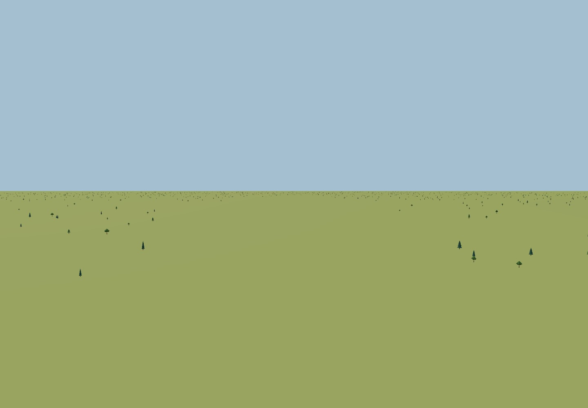
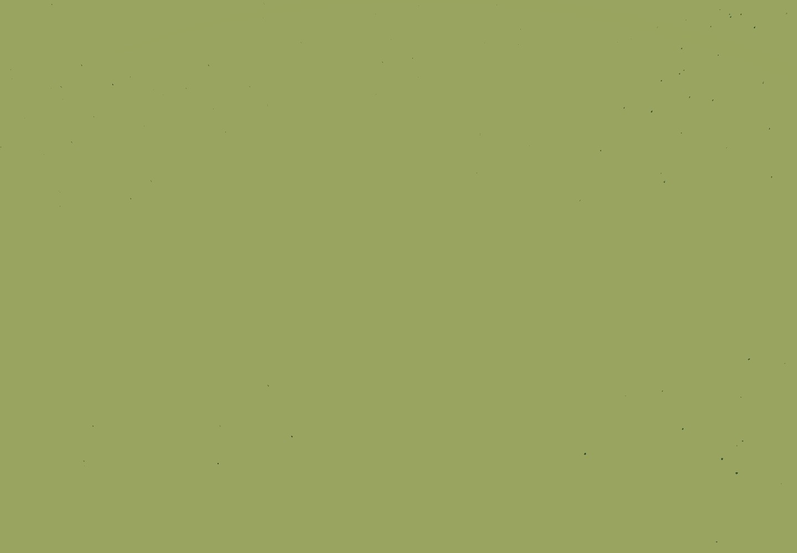

# Vegetation comparison, 2026-10-21

Baseline: `184ec96`. Current source: `codex/issue-10-foliage-lod`.
See [implementation/provenance](../../docs/development/foliage.md) and
[raw measurements](browser-results.json).

## Images

Each pair uses the same camera, 1440 x 1000 resolution, flat ground at 12 m and
fixed daylight. Forest/approach/aerial views use the same seed and identical
3,500 tree centers; the species lineup deliberately places three unit-scale trees
side by side so their silhouettes and shadows can be inspected.

| View | Before | After |
| --- | --- | --- |
| Species lineup |  |  |
| Near forest |  |  |
| Clear approach corridor |  |  |
| Aerial |  |  |

At the identical 650 m camera position, [near geometry](transition-0.jpg) and
[far geometry](transition-1.jpg) remain grounded with matching overall dimensions.
The oak's coarse lobes visibly change shape at this scale (roughly 1–2 pixels on
the crown); this is a discrete LOD, without crossfade. The sequence test verifies
the 100 m hysteresis prevents repeated switches when hovering near a boundary.
Near shadows are visible under each tree; far shadow casting is disabled.
No transparent leaf cards, alpha cutouts or double-sided crowns are involved.

## Measured cost

Windows, Intel Core Ultra 7 256V, Headless Chrome 155, ANGLE Vulkan SwiftShader
(software rendering), Node 22.23.2, Vite 8.3.4. One isolated scene per version,
five warmup frames and twenty measured frames per view, 1024 shadow map, DPR 1.
Times wait for a WebGL GPU fence with 1 ms polling; browser timer clamping and
scheduling are included. These are completed-frame wall times, not timer queries
or hardware GPU FPS. Comparisons were sequential, not statistically randomized.

| View | Median frame ms before → after | P95 ms before → after | Draw calls before → after | Triangles before → after |
| --- | --- | --- | --- | --- |
| Near forest | 195.2 → 166.3 | 205.0 → 177.7 | 3 → 10 | 133,002 → 127,556 |
| Approach | 177.9 → 128.2 | 225.7 → 131.4 | 3 → 6 | 133,002 → 124,562 |
| Aerial | 179.9 → 141.9 | 185.1 → 145.0 | 3 → 4 | 133,002 → 123,658 |

Draw counts include the ground and any shadow pass. Near trees: 19/11/0 in those
views; all other instances use far geometry. Repacking CPU spot measurements:
3.1/0.8/0.9 ms, only after 25 m camera displacement. They are single samples,
not latency guarantees. Lineup measurements are in JSON but excluded from the
performance comparison because it is an artificial three-tree display.

Selected budget after baseline measurement: at most 6 color + 3 near shadow
draws, no vegetation textures, no separate model requests. All measured frames
stay within 10 total draws including the ground. Opaque crowns avoid alpha-card
overdraw; this does not claim zero raster overdraw or a measured overdraw ratio.

Vegetation texture memory stays **0 → 0 bytes**; model/texture HTTP requests and
their transfer size stay **0 → 0**. Geometry is generated from JS. The actual
production main JS grows **1,172,645 → 1,174,601 bytes** (+1,956), or
**310,380 → 311,176 gzip bytes** (+796, Node `gzipSync` default settings).
See [exact bundle byte counts](transfer-results.json). The isolated baseline build
uses the same source revision and Node/Vite dependencies; public assets are not
needed for this bundle comparison. Other existing assets are unchanged.

Browser checks passed with zero runtime exceptions, identical tree positions,
3,500 instances across each LOD split and nonempty near/far scenes. This evidence
does not cover full flights, production/mobile hardware performance, or all
lighting conditions. Reproduce with `scripts/verify-foliage.mjs`.
