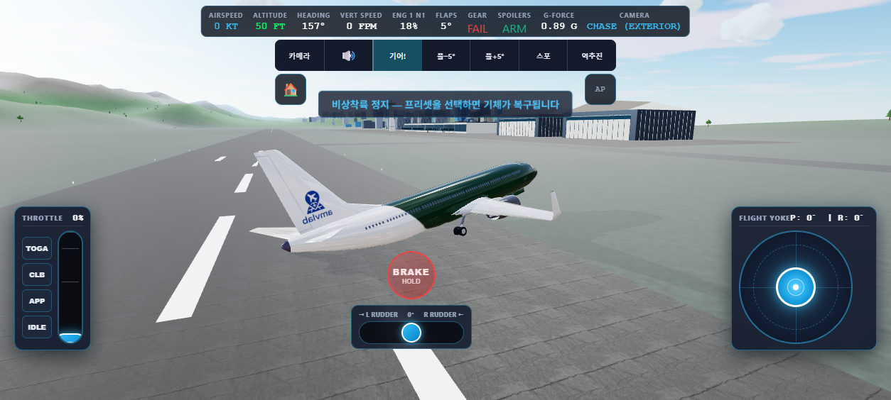
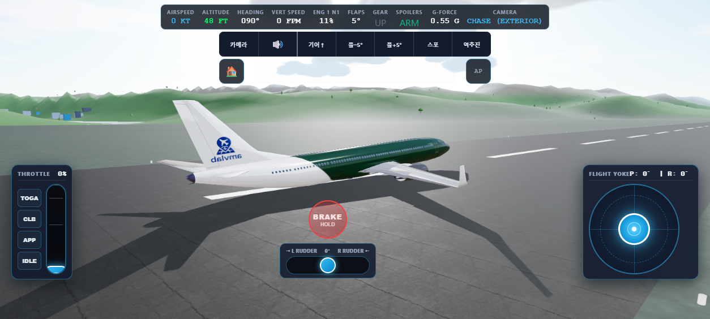
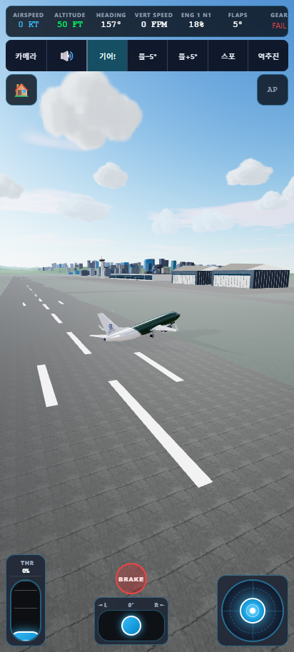

# Issue #167: landing damage evidence

Verified 2026-10-23 on Windows, Node 22.23.2, headless Chrome/SwiftShader,
loaded B737 GLB, coastal airport, 120 Hz simulation. Mobile image uses a
412x915 emulated viewport, not a physical Samsung device.

## Results

- `npm run check`, `npm test` (431 tests), `npm run build`: passed before
  integrating subsequent main changes; final PR CI validates the merged base.
- `npm run test:landing -- --screenshots`: all 10 scenarios passed, no uncaught
  browser exceptions. Left/right/both main collapse, nose collapse and gear-up
  belly landing reached a controlled stop and held for ten more simulated seconds.
- Every sampled support patch stayed within the 0.04 m penetration budget.
  Final visible GLB vertices stayed within the 0.10 m visual tolerance; worst
  observed final mesh penetration was approximately 0.04 m.
- Part damage persisted, remained stable at rest (increase < 1e-4), and reset
  with the preset. Low-side engine thrust decreased independently. Severe impact
  exhausted both nacelles; a >12.5 m/s body impact still caused a fatal crash.
- `npm run test:crash`: tower, water, mountain, building, tree and restart passed.
- Node tests cover separate wing/tail failure, reimpact, damage-rate consistency
  at 60/120/240 Hz, engine restart without repair, analytical slopes, and
  non-increasing kinetic energy under the normal contact constraint.

[Measured scenario summaries](summary.json) retain final/hold states, per-part
health, engine outputs and clearances. Full sample histories are generated by
the test runner. These are gameplay-calibrated limits, not validated aircraft
structural certification values. Dedicated scrape audio, sparks and deformable
meshes are not part of this change. Loaded-DEM Lukla damage sequences and
arbitrary inverted attitudes have not been accepted by this run.

## Reproduce on Windows

Start Vite separately on port 5187 with the repository Node version, then:

```powershell
$env:PORT='5187'
$env:CDP_PORT='9469'
$env:CHROME_BIN='C:/Program Files/Google/Chrome/Application/chrome.exe'
$env:ARTIFACT_DIR='review-artifacts/landing-local'
npm run test:landing -- --screenshots
$env:CDP_PORT='9470'
$env:ARTIFACT_DIR='review-artifacts/crash-local'
npm run test:crash
```

## Images

Left main collapse: support transfers to low-side body patches; no deep sinking.



Gear-up landing after sliding to rest; engines lose output as contact damage rises.



Mobile rendering after left main collapse:


