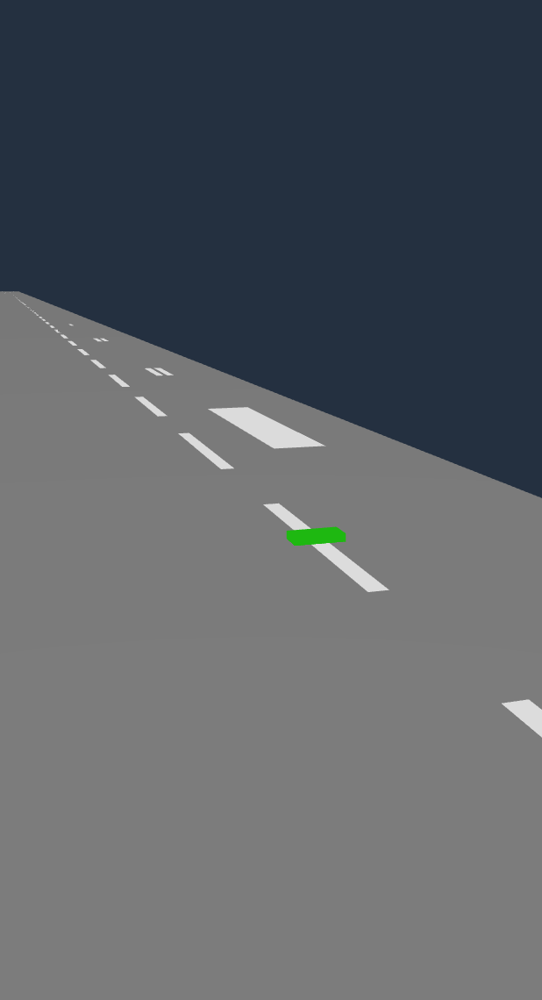
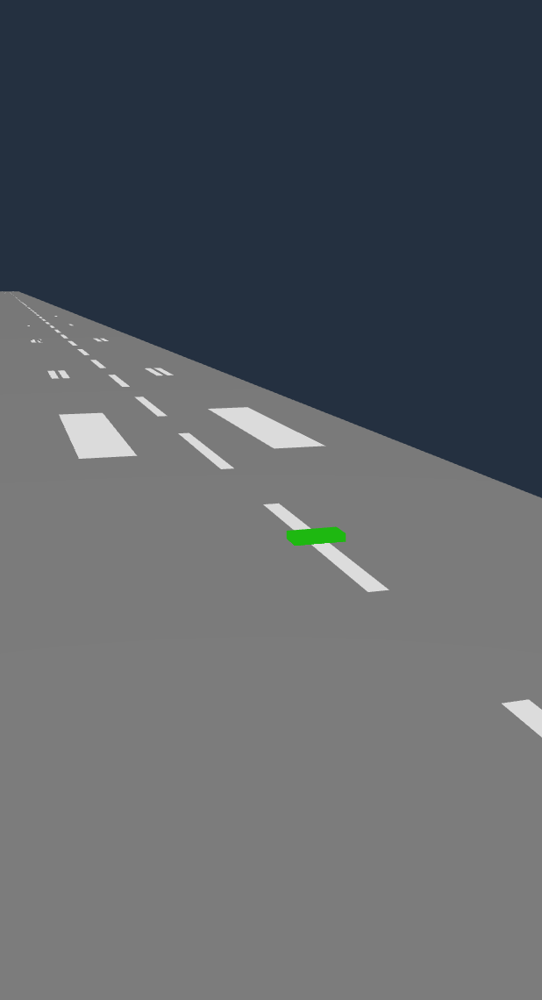
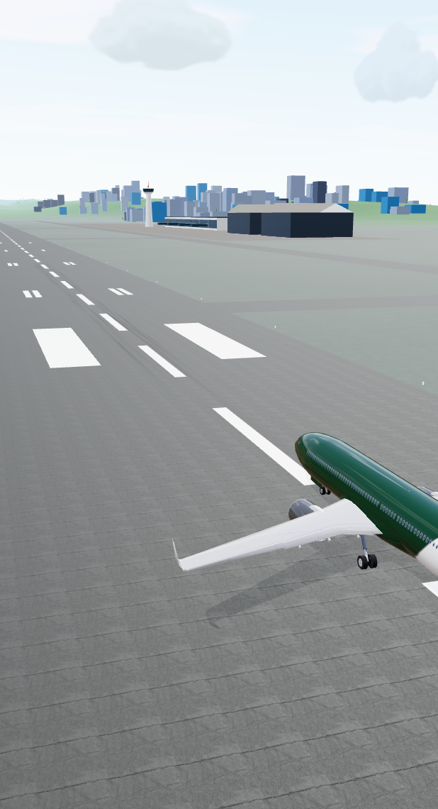
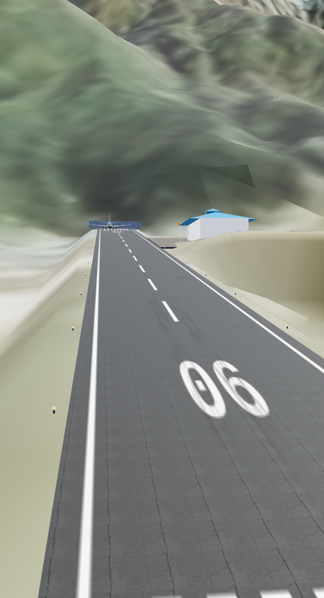

# Runway marking depth evidence

The supplied Android Brave recording shows dark holes intermittently appearing
inside the coastal runway's white paint. The ordinary desktop GPU scene did not
reproduce that symptom. Depth competition is the working diagnosis; the original
phone/driver has **not** been retested and the precise device-specific cause is
not established by this run.

The fix gives only the painted overlays a bounded 5 cm camera-space bias in the
perspective logarithmic fragment depth. It retains the physical geometry, depth
testing, disabled paint depth writes, native polygon-offset fallback, lighting
and shadow receiver positions. Both coastal stripes/numbers and Lukla's canvas
paint use the same material factory.

## Controlled GPU check

Run `scripts/verify-runway-markings.mjs` as described in
[pavement documentation](../../docs/development/pavement.md). Recorded GPU:
Intel ADL-N, ANGLE/Vulkan, Chrome 154 on Linux, 618×1140 render buffer.
[report.json](report.json) contains the actual renderer/browser identity and all
32 frame measurements, plus two projection compatibility checks.

Each airport uses its production runway and marking meshes/materials. Eight
small camera translations are captured with the original and revised shader,
first at normal separation and then with paint exactly coplanar and native
polygon offset disabled. This stress case deliberately removes depth margin;
it is **not** a simulation of the particular Android device or a claim to have
reproduced its driver behavior.

- Normal separation: zero missing interior paint pixels before and after, both airports.
- Coastal stress: worst missing-pixel count drops from 4,745 to 2; the revised
  worst missing fraction is below 0.027%, with a 0.1% acceptance limit.
- Lukla stress: zero missing interior paint pixels before and after on this GPU.
- Zero lost interior pixels of the green foreground block, across all frames.
- Ordinary perspective and orthographic comparisons: nonempty renders with zero
  changed channels between old/new shader; no browser or shader errors.

The reference omits only the pavement and retains foreground occlusion. Its
eroded white mask excludes antialiasing boundaries. Small residual differences
at distant paint/number coverage are retained in the report rather than counted
as a perfect pixel match.

## Full application smoke check

The actual application was also rendered at performance/balanced/high quality
for both airports, with the loaded aircraft, terrain and normal lighting/shadows.
All six renders had zero reported WebGL errors and zero failed shader programs.
Selected balanced-quality captures:

This is rendering evidence, not a native Android acceptance run, complete flight
test or frame-rate benchmark. Local `npm run check`, all 446 Node tests, and
`npm run build` passed separately.
