# Ship exterior comparison

Conditions, provenance, budgets and limitations: [ship documentation](../../docs/development/ships.md).
Measurements and environment: [browser-results.json](browser-results.json).

| View | Before | After |
| --- | --- | --- |
| Cargo | 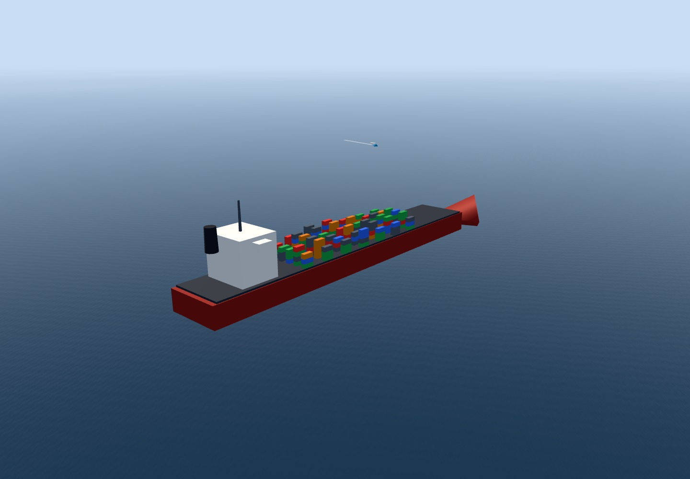 | 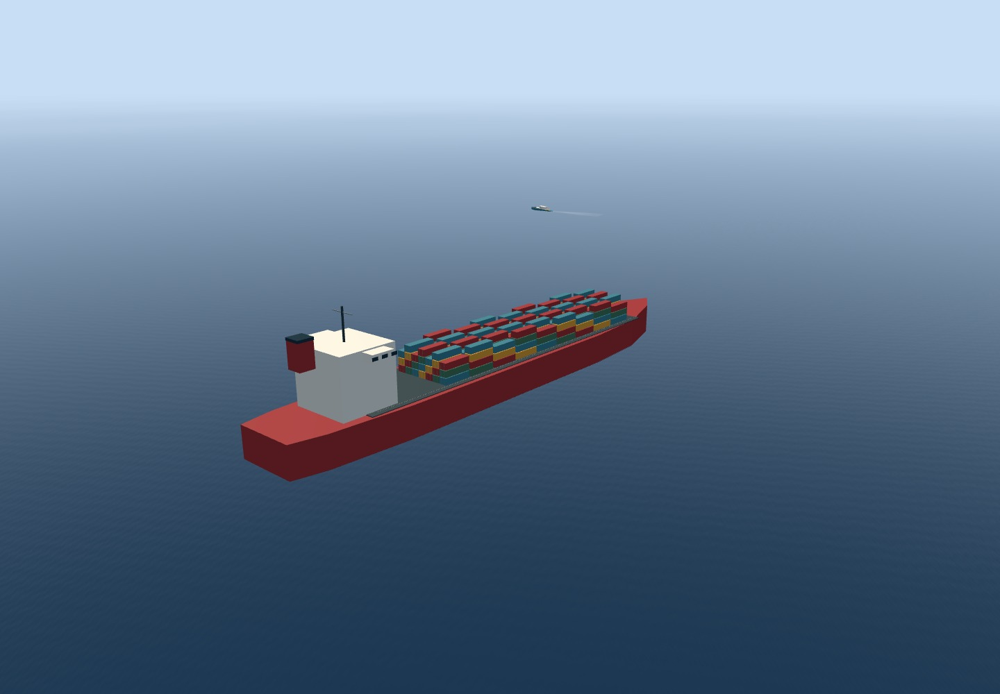 |
| Cruise | 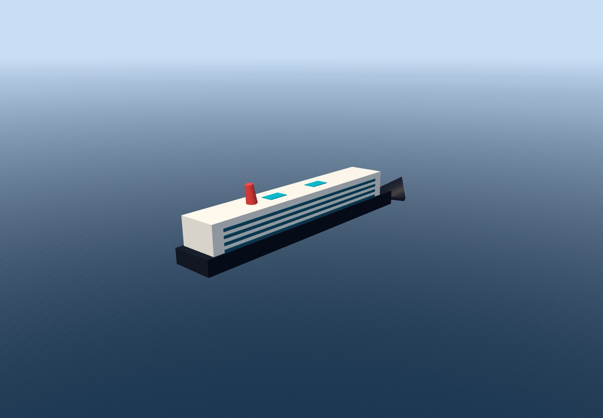 | 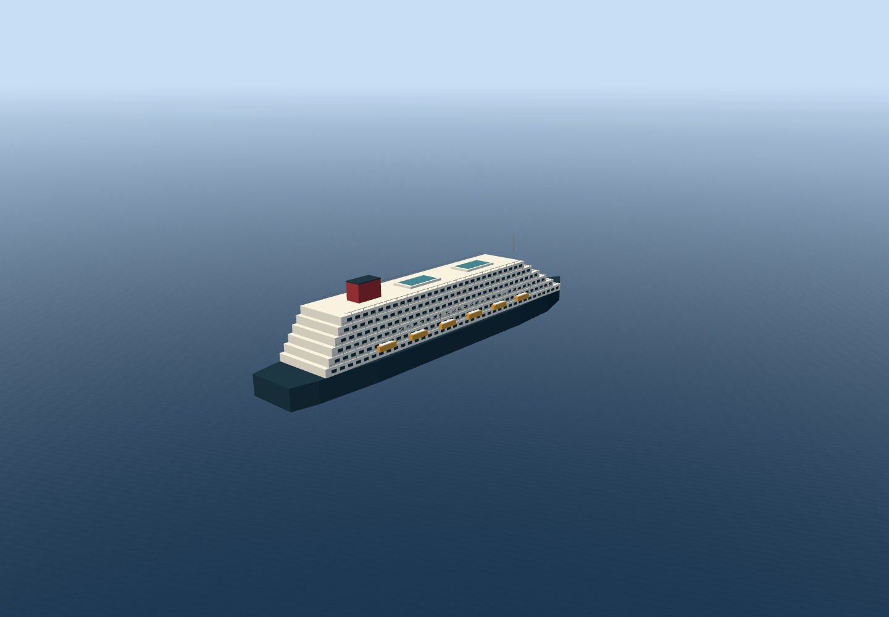 |
| Tanker | 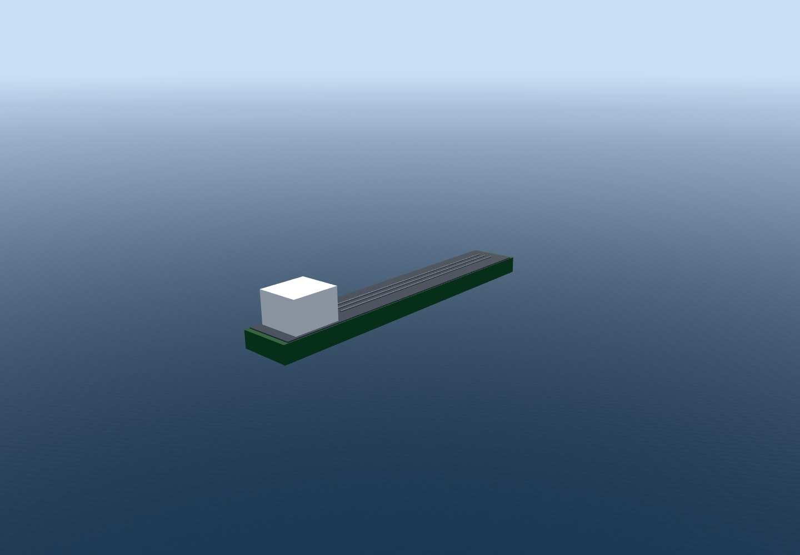 | 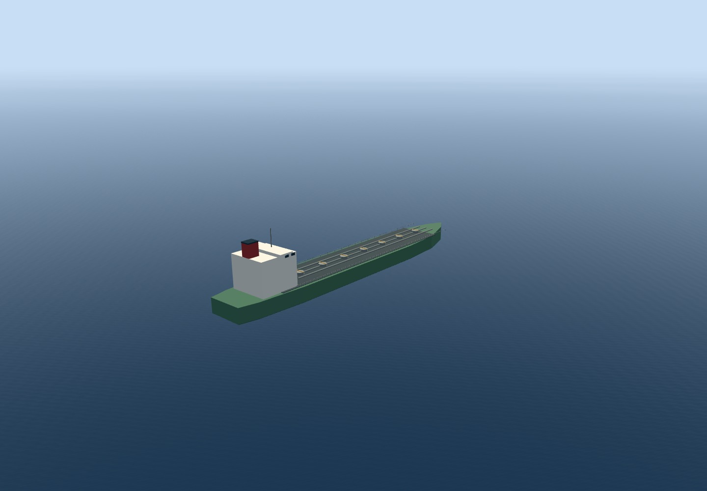 |
| Speedboat | 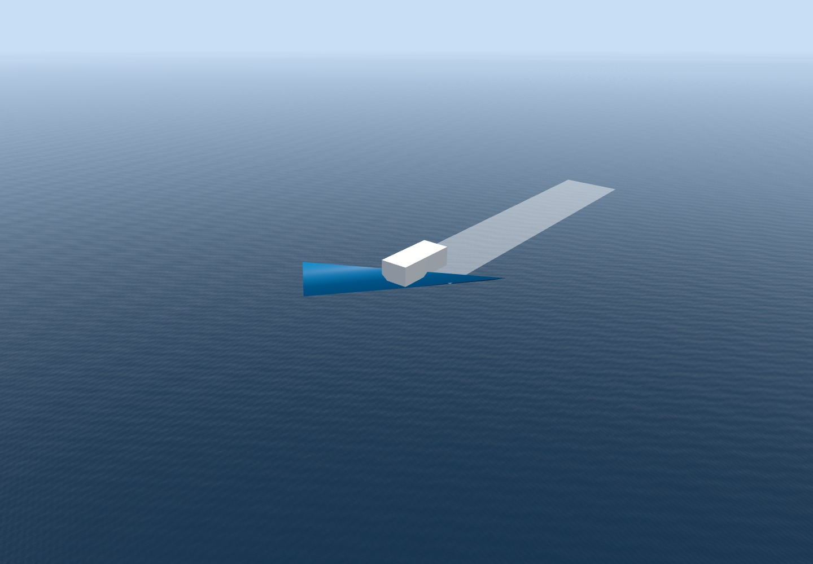 | 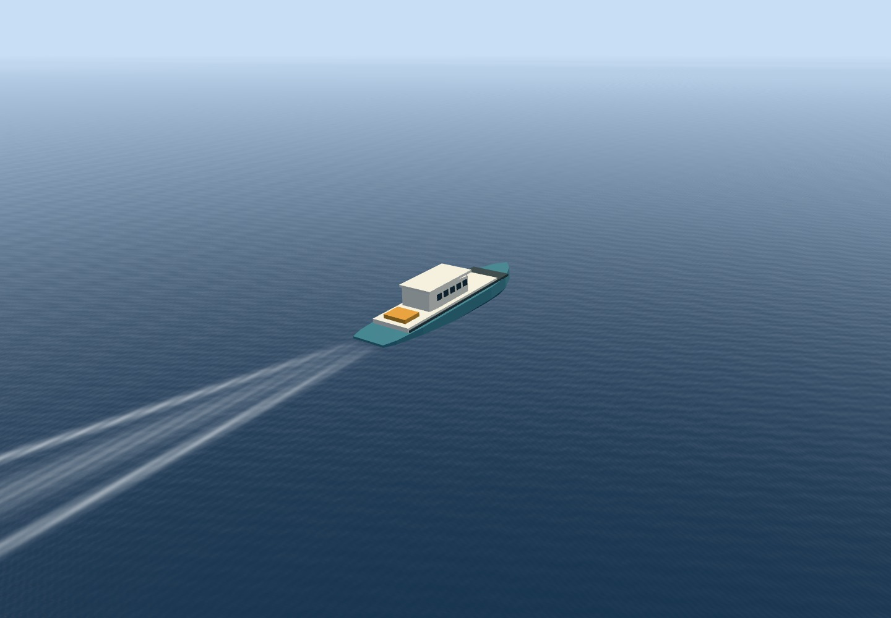 |
| Waterline | 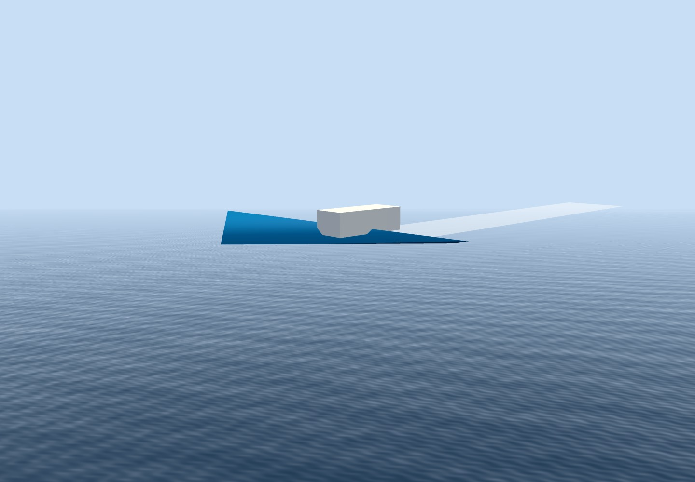 | 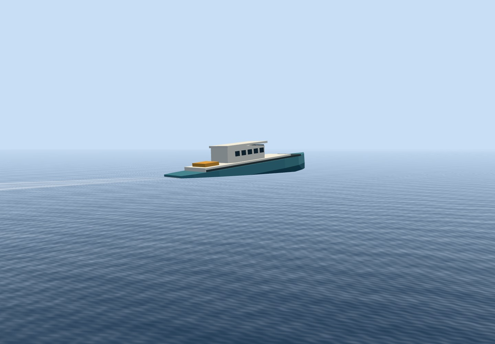 |

Additional waterline phases, following the moving boat:

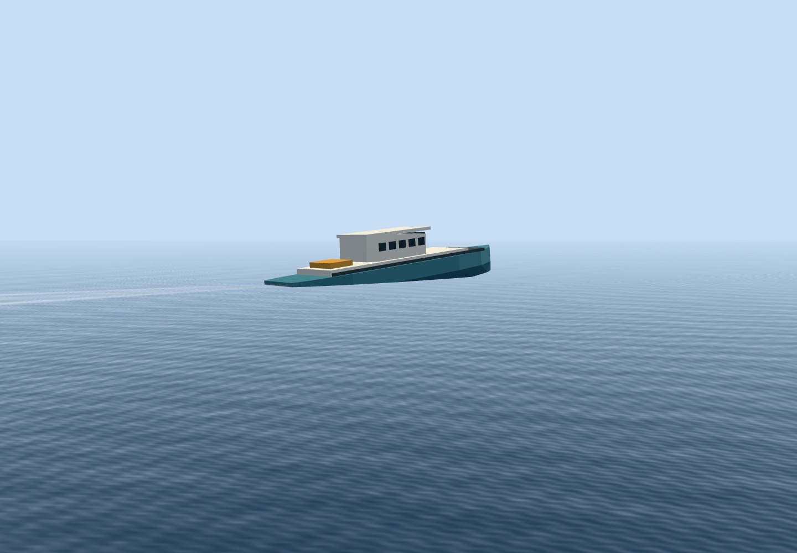
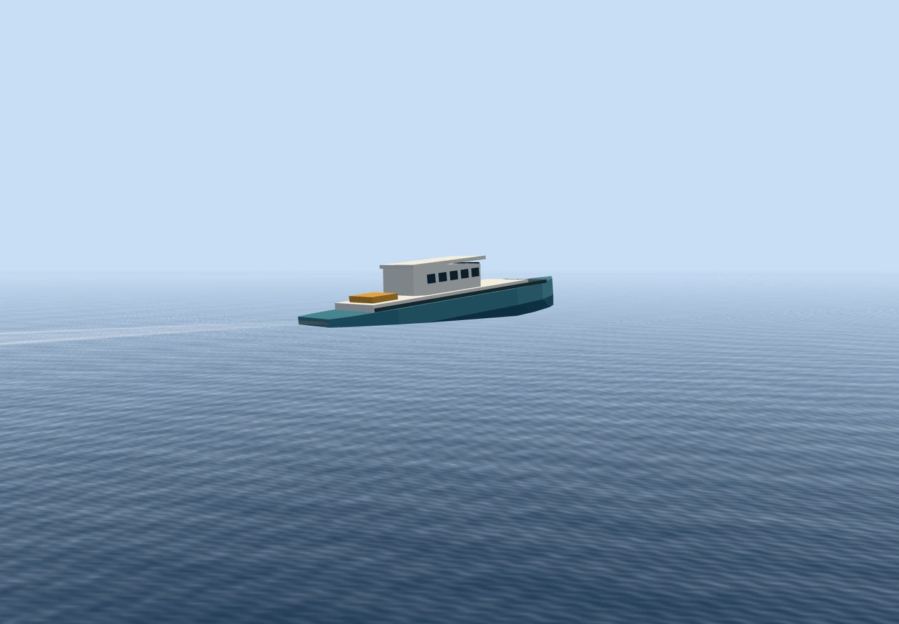
